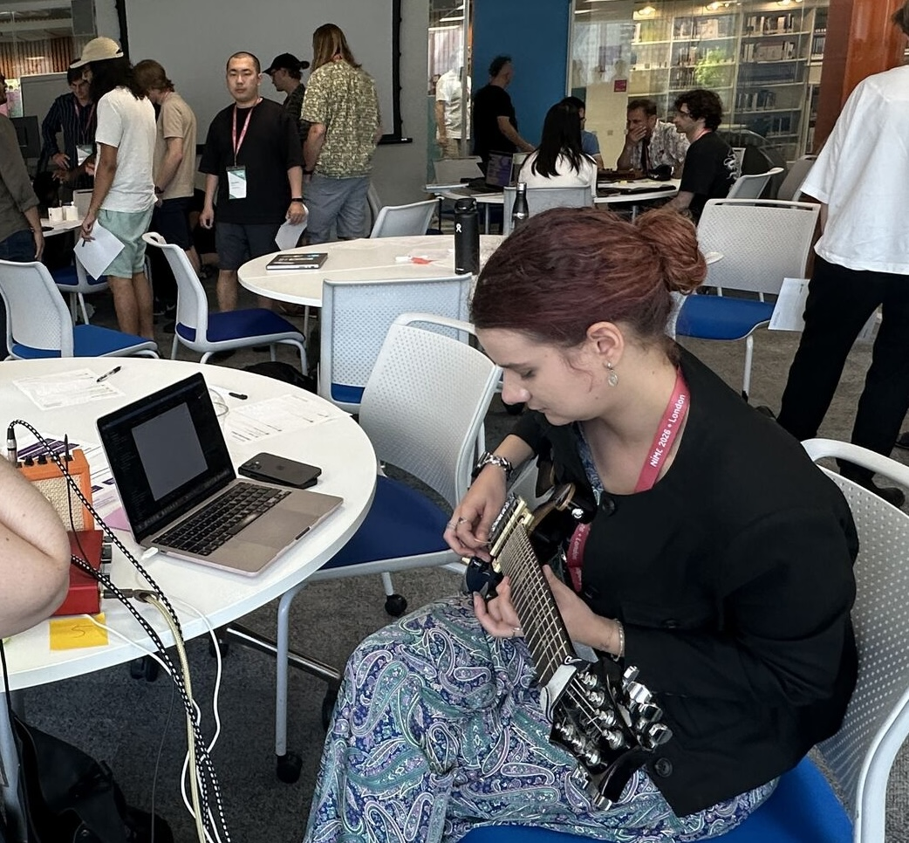
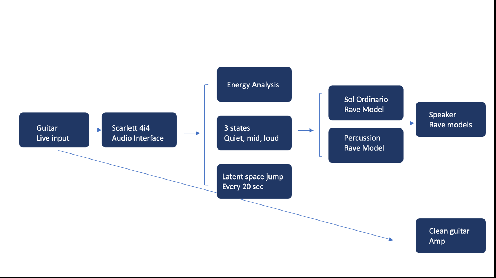

# Playing with RAVE

**Guitar dynamics as an interface for neural audio collaboration.**

A live performance system that combines electric guitar with two [RAVE](https://github.com/acids-ircam/RAVE) models. How loudly the guitar is played sets the balance between an orchestral model (Sol Ordinario) and a percussion model, and every 20 seconds both models jump to a random point in their latent space.

## Demo

*Click the image to watch the demo on YouTube.*

## Where it has been shown

- Performed in three live contexts, including a demo at the NIME 2026 workshop *"What Makes it Fun? Mapping Playful Interaction in Music-Making with AI"*.
- Accepted for presentation at the **AI in Art Practices and Research Conference 2026**: *"Playing with RAVE: Guitar Dynamics as an Interface for Neural Audio Collaboration"*. A research paper is to follow.

   
  <em>At the NIME 2026 workshop.</em>

## How it works

  

The guitar's amplitude is analysed in real time and mapped across three states:

| State | What you hear |
|-------|---------------|
| **Quiet** | Sol Ordinario (orchestral model) only |
| **Mid** | Both models mixed |
| **Loud** | The percussion model dominates |

Every 20 seconds both models jump to a new random point in their latent space. This brings unpredictability for both the performer and the audience: the guitar steers the sound, but never fully controls it. The clean guitar signal also goes to the amp, so the acoustic gesture stays audible alongside the generated sound.

## Why RAVE?

RAVE (Realtime Audio Variational autoEncoder) is a neural audio model that runs fast enough for live use. Its compact latent space can be explored while the performer plays, which makes it a natural fit for a performance instrument. In this project the guitar acts as the controller and the RAVE models act as a responsive, slightly unpredictable collaborator.

## References

- Caillon, A. and Esling, P. (2021). *RAVE: A variational autoencoder for fast and high-quality neural audio synthesis.* arXiv:2111.05011.

## Author

Daria Cotocu · [dariacotocu.com](https://dariacotocu.com)
